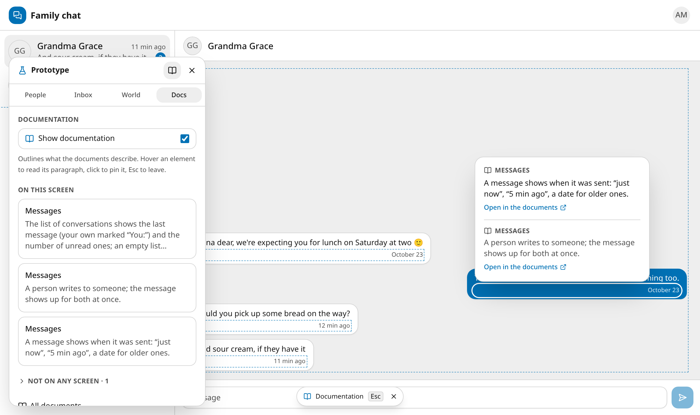

# protokit

**Product prototypes that look and work like the real thing — on a simulated server, tied
paragraph by paragraph to their documents.**



protokit is a starter kit for clickable prototypes built by an AI agent (or by hand) from a
project's requirement documents. There is no backend: GraphQL requests run in the browser
against a schema and resolvers you write as plain functions. Yet the prototype behaves like
a service — it starts at sign-in, sends codes by "email", lets time pass, goes offline, and
two browser tabs can be two different people talking to each other.

- **A product, not a mockup.** Every state is reached by acting — a wrong password, an
  expired deadline, a lost connection — never by flipping a switch on the screen.
- **A standard panel**, the same in every prototype, folded into a tab on the screen's
  edge; the tab and the open panel are dragged out of the way and stay where they were put:
  - **People** — whose eyes this tab sees through (a fake token per tab, one shared world);
  - **Inbox** — letters and texts the system sent, codes, buttons for outside actions;
  - **World** — move time forward, cut the network, trigger events, switch the theme, reset;
  - **Docs** — the requirements behind this screen, what no screen shows, and
    **documentation mode**: hover any element to read the paragraph it implements and jump
    to it.
- **Synced with the documents** through [docc](https://github.com/uxname/docc), strictly:
  every paragraph has a permanent code (`K7F2`), every file of rules and screens names
  the paragraphs it implements together with the version of each it was checked against,
  and carries the print of its own code. Edit a paragraph — the code that depends on it
  stops passing the check; edit the code — so do its paragraphs; the commit waits until
  an agent has read both sides and updated each link by hand.
- **Design held to a bar**: shadcn/ui, light and dark themes, phone and desktop, every
  loading, empty, error and offline state — and screenshots of every path for review.
- **Static output.** `npm run build` gives a folder you can put on any static host and
  send to a client.

## Quick start (the demo)

You need Node.js 22+ and [docc](https://github.com/uxname/docc):

```bash
curl -fsSL https://raw.githubusercontent.com/uxname/docc/main/install.sh | sh
git clone https://github.com/uxname/protokit && cd protokit/prototype
npm install
npm run dev
```

Sign in as `anna@millers.family` / `sunny-river`, or pick anyone in the panel's
**People**. Open a second tab as Ben and write to each other. In **World**, press "+1 day"
or switch the network off. In **Docs**, turn on documentation mode and hover around.

## With an AI agent

The repository carries a skill — instructions an agent follows to build and maintain a
prototype from your documents: [`skill/SKILL.md`](skill/SKILL.md).

Claude Code:

```bash
npx -y degit uxname/protokit/skill ~/.claude/skills/protokit
```

Other agents: point them at `skill/SKILL.md`. Then, in a repository with your documents,
ask: "make a prototype from the docs".

## Your own prototype by hand

From the folder with your `docc.json`:

```bash
npx -y degit uxname/protokit/prototype prototype
cd prototype && npm install
```

Then follow [`skill/references/setup.md`](skill/references/setup.md): remove the demo,
describe your server in `src/spec` and `schema.graphql`, write screens in `src/screens`,
paths in `tests/journeys.spec.ts`. The screen rules are in
[`prototype/DESIGN.md`](prototype/DESIGN.md).

## The idea: agents keep the links, people read

The documents and the prototype are written by AI agents; people read them, point at a
paragraph by its code and comment. Nobody should have to remember which screen follows
which paragraph — the agents carry that routine, and the compiler (docc) makes a missed
link impossible to commit: every link holds the hash of the version it was checked
against, every file the print of its code, and there is no command that confirms them
in bulk — an agent rewrites each one in its place, after reading the change. An edit of
the prototype forces the documents to be checked, an edit of the documents forces the
prototype.

## How it is built

```
docc.json, docs/        the demo's requirement documents (docc)
skill/                  the agent skill: SKILL.md, references, check-sync
prototype/
  src/kit/              the kit: panel, world, sessions, clock, simulated server — never edited
  src/spec/             your server: data model, seed world, rules, resolvers, events
  src/screens/          your screens; src/components/ — your app frame
  src/ui/               shadcn/ui primitives
  tests/                smoke.spec.ts (the kit) and journeys.spec.ts (your paths)
```

Vite, React 19, TanStack Router, Tailwind CSS 4, shadcn/ui, urql + graphql-js, Zustand,
Biome, Playwright.

## Checks

```bash
docc check --max-warnings 0              # documents and their links to code
node skill/scripts/check-sync.mjs        # every requirement paragraph is covered
cd prototype && npm run check            # Biome and TypeScript
npm run test:e2e                         # the panel, the paths, the screenshots
```

## Credits

protokit grew out of [LiteFront](https://github.com/uxname/litefront) — its design system
and component set — cut down to what a prototype needs.

## License

MIT
